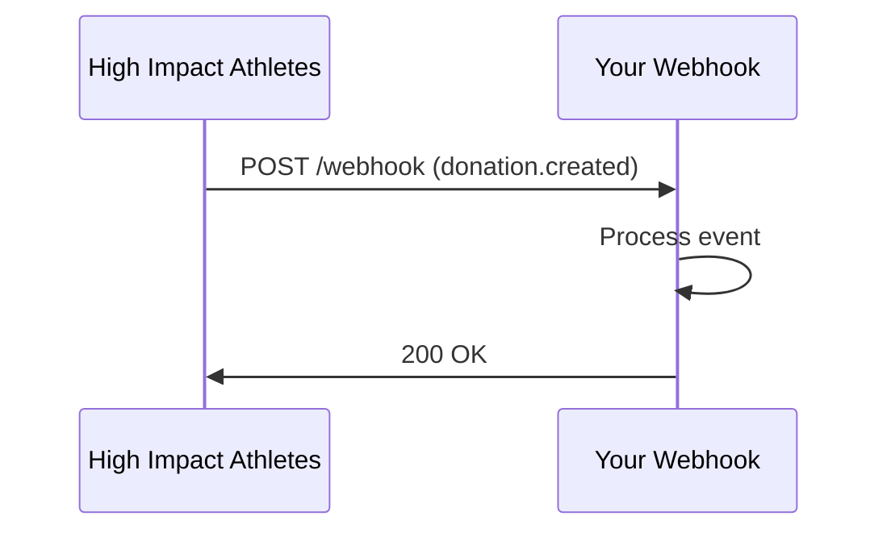

## Overview

High Impact Athletes supports seamless integrations with popular third-party services. You can connect payment processors for donations, social platforms for campaign sharing, email providers for notifications, webhooks for real-time updates, and event platforms like HYROX for athlete competitions. These connections enhance user engagement and automate workflows.

<Columns cols={2}>
  <Card title="Payment Gateways" icon="credit-card" href="#payment-gateways">
    Accept donations securely with Stripe or PayPal.
  </Card>
  <Card title="Social Media" icon="share-2" href="#social-media">
    Share campaigns effortlessly on Twitter and Facebook.
  </Card>
  <Card title="Email Services" icon="mail" href="#email-services">
    Send automated notifications via SendGrid or Mailchimp.
  </Card>
  <Card title="Webhooks" icon="zap" href="#webhooks">
    Receive real-time event updates.
  </Card>
  <Card title="Event Platforms" icon="calendar" href="#event-platforms">
    Sync with HYROX and similar services.
  </Card>
</Columns>

## Payment Gateway Setups

Set up payment gateways to handle donations during athlete campaigns. Start by generating API keys from your provider dashboard.

<Tabs>
  <Tab title="Stripe" icon="credit-card">
    <Steps>
      <Step title="Create Stripe Account" icon="user">
        Sign up at Stripe and obtain your publishable and secret keys.
      </Step>
      <Step title="Configure in Dashboard" icon="settings">
        Navigate to High Impact Athletes dashboard > Integrations > Payments, then enter your Stripe keys.
      </Step>
      <Step title="Test Payment" icon="play">
        Use test mode to simulate a donation.
      </Step>
    </Steps>
  </Tab>
  <Tab title="PayPal" icon="dollar-sign">
    Follow similar steps but use PayPal's client ID and secret.
  </Tab>
</Tabs>

<CodeGroup tabs="JavaScript,Python">
  ```javascript
  const stripe = require('stripe')('YOUR_STRIPE_SECRET_KEY');
  const paymentIntent = await stripe.paymentIntents.create({
    amount: 2000,
    currency: 'usd',
    metadata: { athleteId: 'athlete-123' }
  });
  ```
  ```python
  import stripe
  stripe.api_key = 'YOUR_STRIPE_SECRET_KEY'
  payment_intent = stripe.PaymentIntent.create(
    amount=2000,
    currency='usd',
    metadata={'athleteId': 'athlete-123'}
  )
  ```
</CodeGroup>

<Callout kind="tip">
  Always use test keys during development to avoid real charges.
</Callout>

## Social Media Integration for Campaigns

Enable one-click sharing for athlete campaigns on social platforms. This boosts visibility and community engagement.

<Steps>
  <Step title="Enable Sharing" icon="share">
    In your dashboard, go to Campaigns > Settings > Social Integrations and toggle on platforms.
  </Step>
  <Step title="Add App IDs" icon="settings">
    Enter your Twitter API key and Facebook App ID.
  </Step>
  <Step title="Test Share Button" icon="play">
    Create a sample campaign and verify shares post correctly.
  </Step>
</Steps>

## Email and Notification Services

Connect email providers to send automated updates like competition results or donation confirmations.

<Tabs>
  <Tab title="SendGrid" icon="mail">
    <ParamField header="Authorization" param-type="string" required="true">
      Bearer `YOUR_SENDGRID_API_KEY`
    </ParamField>
  </Tab>
  <Tab title="Mailchimp" icon="mail">
    Use your Mailchimp API key for audience management.
  </Tab>
</Tabs>

## Webhook Configurations for Updates

Webhooks notify your systems of events like new donations or athlete registrations in real-time.

Configure the webhook URL in your High Impact Athletes dashboard: `https://your-webhook-url.com/highimpact`.

<Request tabs="cURL,JavaScript" show-lines="true">
  ```bash
  curl -X POST https://api.example.com/v1/webhooks \
    -H "Authorization: Bearer YOUR_API_KEY" \
    -H "Content-Type: application/json" \
    -d '{"url": "https://your-webhook-url.com/highimpact", "events": ["donation.created", "athlete.registered"]}'
  ```
  ```javascript
  await fetch('https://api.example.com/v1/webhooks', {
    method: 'POST',
    headers: {
      'Authorization': 'Bearer YOUR_API_KEY',
      'Content-Type': 'application/json'
    },
    body: JSON.stringify({
      url: 'https://your-webhook-url.com/highimpact',
      events: ['donation.created', 'athlete.registered']
    })
  });
  ```
</Request>

<Response tabs="200">
  ```json
  {
    "id": "webhook_123",
    "url": "https://your-webhook-url.com/highimpact",
    "events": ["donation.created", "athlete.registered"],
    "status": "active"
  }
  ```
</Response>



<Expandable title="Advanced Webhook Security" default-open="false">
  Use HMAC signatures to verify payloads. Compute `sha256(payload + YOUR_WEBHOOK_SECRET)` and compare with the `X-Signature` header.
</Expandable>

## Partnerships with Event Platforms

Integrate with platforms like HYROX to sync athlete data and competition results.

<Callout kind="info">
  Contact partnerships@highimpactathletes.com for custom HYROX API access.
</Callout>

Visit the [HYROX developer portal](https://hyrox.com/developers) for OAuth setup, then link via our dashboard.

<Columns cols={2}>
  <Card title="Sync Athletes" icon="users" horizontal>
    Automatically import participant data.
  </Card>
  <Card title="Track Results" icon="trending-up" horizontal>
    Pull live leaderboards into campaigns.
  </Card>
</Columns>