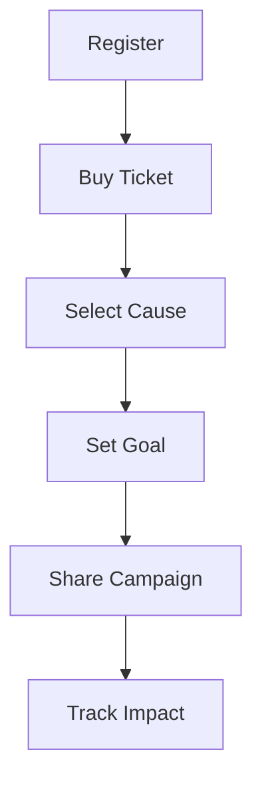

## Prerequisites

Before diving in, ensure you have the following ready:

<Callout kind="info">

- An active email address for registration
- Payment method for purchasing HYROX charity tickets
- Your favorite high-impact cause selected from global challenges like climate or health

</Callout>

You compete not just for personal bests, but for real-world change. High Impact Athletes transforms HYROX events into fundraising powerhouses.

## Create Your Account and Log In

Start by signing up on the High Impact Athletes platform.

<Steps>
  <Step title="Register" icon="user-plus">
    Visit `https://app.highimpactathletes.com/register` and enter your email, name, and password.
    
    Confirm your email via the verification link sent to your inbox.
  </Step>
  <Step title="Log In" icon="log-in">
    Navigate to `https://app.highimpactathletes.com/login`.
    
    Enter your credentials to access the dashboard.
  </Step>
</Steps>

## Purchase Charity Event Tickets

Select and buy tickets for upcoming HYROX events with built-in fundraising.

<Tabs>
  <Tab title="Paris Grand Palais" icon="map-pin">
    Event date: 23 APR 2026
    
    <Callout kind="tip">
      Tickets include fundraising tools to rally your community.
    </Callout>
    
````bash
# Example ticket purchase flow (via dashboard)
1. Select Paris event
2. Choose charity ticket option
3. Complete payment with Stripe
````
  </Tab>
  <Tab title="Lisbon" icon="globe">
    Event date: 1 MAY 2026
    
    Secure your spot and activate fundraising instantly.
    
````javascript
// Simulate ticket API call (for reference)
fetch('https://api.highimpactathletes.com/tickets/lisbon', {
  method: 'POST',
  body: JSON.stringify({ quantity: 1, cause: 'climate' })
});
````
  </Tab>
</Tabs>

## Select Causes and Set Goals

Choose from vetted high-impact causes and define your fundraising targets.

<ParamField path="cause" param-type="string" required="true">
  Select from `climate`, `health`, `education`, or `poverty`.
</ParamField>

<ParamField path="goal" param-type="number" required="false">
  Set a target amount, e.g., `$5000`.
</ParamField>

<Steps>
  <Step title="Pick Your Cause" icon="heart">
    From the dashboard, browse causes and select one aligned with your purpose.
  </Step>
  <Step title="Set Goals" icon="target">
    Input your fundraising goal and team size.
  </Step>
  <Step title="Configure Profile" icon="settings">
    Upload your athlete profile photo, bio, and team details.
  </Step>
</Steps>

## Launch Your First Fundraising Campaign

Share your campaign across platforms to inspire donations.

<CodeGroup tabs="HTML,JavaScript">
````html
<!-- Embed fundraiser widget on your site -->
<div id="hia-fundraiser" data-campaign="your-campaign-id"></div>
<script src="https://app.highimpactathletes.com/widget.js"></script>
````
````javascript
// Share campaign link programmatically
const campaignUrl = 'https://app.highimpactathletes.com/campaigns/your-campaign-id';
navigator.share({ title: 'Join my High Impact Athletes challenge!', url: campaignUrl });
````
</CodeGroup>

Track progress in real-time on your dashboard at `https://app.highimpactathletes.com/dashboard`.

## Configure Team and Share

Invite teammates and amplify your impact.

<Expandable title="Advanced Team Setup" default-open="false">

Create teams for collaborative fundraising:

1. Go to `Team` tab
2. Invite via email or link
3. Assign roles: captain, member

</Expandable>

## Next Steps

<Columns cols={2}>
  <Card title="Explore Leaderboards" icon="trophy" href="/leaderboards">
    See top fundraisers and compete globally.
  </Card>
  <Card title="Resources" icon="book-open" href="/resources">
    Access training guides and cause deep dives.
  </Card>
  <Card title="Causes" icon="globe" href="/causes">
    Learn about supported high-impact areas.
  </Card>
  <Card title="Help Center" icon="help-circle" href="/help">
    Get support for any issues.
  </Card>
</Columns>

<Callout kind="success">
  You're ready to race with purpose! Share your campaign today and track donations live.
</Callout>

